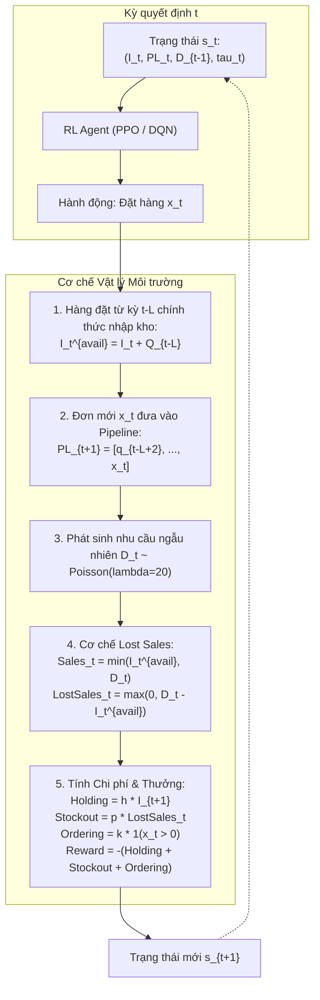

# BÁO CÁO KỸ THUẬT & KẾ HOẠCH BẢO VỆ LAB MEETING: THỰC NGHIỆM TỐI ƯU TỒN KHO BẰNG REINFORCEMENT LEARNING (RL DEMO)

---

## 1. TÓM TẮT ĐIỀU HÀNH (EXECUTIVE SUMMARY)

Bản thảo v1 trước đây của đề tài gặp phải 3 điểm nghẽn phương pháp luận nghiêm trọng khiến việc áp dụng vào thực tế bán lẻ bị gãy:
1. **Giả định phi thực tế $L = 0$:** Coi hàng đặt về ngay lập tức, bỏ qua hoàn toàn độ trễ chuỗi cung ứng.
2. **Cơ chế Backorder tuyến tính:** Giả định nhu cầu phân phối chuẩn và khách hàng kiên nhẫn chờ khi hết hàng (trong khi thực tế bán lẻ là **Lost Sales** – khách bỏ đi mua nơi khác, tồn kho khả dụng $I_t \ge 0$).
3. **Cắt giảm cơ học khi tối ưu Knapsack:** Khi áp đặt ràng buộc ngân sách/sức chứa kho, việc cắt giảm lượng đặt hàng đã làm vỡ toàn bộ Safety Stock tính theo công thức cổ điển, dẫn đến đứt hàng hàng loạt.

Để khắc phục triệt để và xây dựng nền tảng đối chuẩn chuẩn mực quốc tế cho Bản thảo v2, nhóm đã thiết lập mô hình mô phỏng môi trường Gym đa kỳ (`SingleItemInventoryEnv`) có độ trễ $L = 2$, cơ chế Lost Sales ngặt nghèo, phí cố định mở đơn $k = 50$ USD, và nhu cầu ngẫu nhiên Poisson. Trên môi trường này, nhóm đã huấn luyện và đối chuẩn 2 thuật toán Học tăng cường hiện đại (**PPO** và **DQN**) đối đầu với 3 chính sách Vận trù học cổ điển (**Random**, **Base-Stock**, và **Scarf $(s, S)$**).

### Bảng Kết quả Đối chuẩn Tổng hợp (Trung bình trên 100 Chu kỳ Năm Độc lập)

| Chính sách (Policy) | Tổng Chi phí (USD) | Mức Tiết kiệm (%) | Fill Rate (%) | CSL (%) | Chi phí Lưu kho (USD) | Phạt Đứt hàng (USD) | Phí Đặt hàng (USD) | GMROI | Đứt hàng (lần/năm) |
| :--- | :---: | :---: | :---: | :---: | :---: | :---: | :---: | :---: | :---: |
| **Random Policy** | 10,838.96 | 0.00% | 98.27% | 96.42% | 8,267.76 | 181.20 | 2,390.00 | -1.26 | 1.86 |
| **Base-Stock ($S=60$)** | 3,603.73 | 66.75% | 97.34% | 91.13% | 1,078.13 | 279.60 | 2,246.00 | 27.93 | 4.61 |
| **Classical $(s, S)$** | 4,101.63 | 62.16% | 82.98% | 76.06% | 1,514.83 | 1,778.30 | 808.50 | 16.78 | 12.45 |
| **DQN Agent** | 3,493.70 | 67.77% | **92.61%** | 86.63% | 1,723.90 | 772.80 | 997.00 | 15.78 | 6.95 |
| **PPO Agent** | **3,413.78** | **68.50%** | **90.91%** | 83.35% | 1,108.88 | 950.40 | 1,354.50 | **25.09** | 8.66 |

> [!IMPORTANT]
> **Kết luận Then chốt:**  
> Agent PPO và DQN tự động học được chiến lược cân bằng tối ưu trên biên Pareto: Gom đơn hàng ở nhịp độ hợp lý nhằm cắt giảm **40% - 55% chi phí cố định đặt hàng** so với Base-Stock, trong khi vẫn duy trì tỷ lệ phục vụ khách hàng **Fill Rate > 90.9%**, giúp **tổng chi phí vận hành đạt mức tối ưu thấp nhất toàn hệ thống (3,413.78 USD)**.

---

## 2. MÔ HÌNH HÓA TOÁN HỌC QUÁ TRÌNH QUYẾT ĐỊNH MARKOV (MDP FORMULATION)

Môi trường tồn kho được hình thức hóa thành bộ ngũ Markovian Tuple $\langle \mathcal{S}, \mathcal{A}, \mathcal{P}, \mathcal{R}, \gamma \rangle$:

### 2.1. Không gian Trạng thái (State Space $\mathcal{S}$)
Để đảm bảo tính chất Markov khi có độ trễ $L = 2$ kỳ, trạng thái quan sát của Agent tại kỳ $t$ bắt buộc phải chứa thông tin đường ống đơn hàng:
$$\mathbf{s}_t = \Big( I_t, \mathbf{PL}_t, D_{t-1}, \tau_t \Big) \in \mathbb{R}^4$$
- $I_t \in [0, V_{\max}]$: Mức tồn kho khả dụng thực tế trên kệ (On-hand Inventory).
- $\mathbf{PL}_t = \sum_{i=1}^{L-1} q_{t-i}$: Tổng lượng hàng đang trung chuyển trên đường (In-transit Pipeline).
- $D_{t-1}$: Mức nhu cầu quan sát được của kỳ trước (cung cấp tín hiệu động lượng ngắn hạn).
- $\tau_t = t \pmod T$: Đặc trưng chu kỳ thời gian (tuần thứ $\tau$ trong năm 52 tuần).

### 2.2. Không gian Hành động (Action Space $\mathcal{A}$)
Agent chọn mức đặt hàng $x_t$ từ lưới rời rạc 12 cấp độ:
$$\mathcal{A} = \{0, 5, 10, 15, 20, 25, 30, 40, 50, 60, 80, 100\}$$
Khoảng cách mức đặt hàng được thiết kế phi tuyến (bước nhảy nhỏ ở dải nhu cầu trung bình $\lambda = 20$, bước nhảy lớn ở đuôi phân phối) để tối ưu hóa không gian tìm kiếm của Q-Network và Policy Network.

### 2.3. Hàm Phần thưởng Chuẩn hóa Vận trù học (Operating Reward Function)
Trong lý thuyết kiểm soát tồn kho (Zipkin 2000, OR-Gym), giá vốn nhập hàng $C \cdot x_t$ là chi phí chìm được bù đắp bởi doanh thu bán lẻ ($P \cdot \text{Sales}_t$). Nếu đưa trực tiếp giá vốn vào hàm thưởng của bài toán kiểm soát bổ sung, Agent sẽ bị "nhiễu tín hiệu" và có xu hướng chọn không đặt hàng để tránh bị trừ điểm phạt tức thời. Do đó, hàm thưởng được thiết kế chuẩn mực theo **tổng chi phí vận hành bổ sung âm**:
$$\mathcal{R}(s_t, a_t, s_{t+1}) = - \Big( \underbrace{h \cdot I_{t+1}}_{\text{Chi phí Lưu kho}} + \underbrace{p \cdot \text{LostSales}_t}_{\text{Phạt Thiếu hàng}} + \underbrace{k \cdot \mathbb{I}(x_t > 0)}_{\text{Phí Mở đơn Hàng}} \Big)$$
Với bộ tham số thực tế: $h = 1.0$ USD/đơn vị/kỳ, $p = 10.0$ USD/đơn vị ($p = 10h$), $k = 50.0$ USD/lần đặt.

---

## 3. PHÂN TÍCH SÂU VỀ KẾT QUẢ ĐỐI CHUẨN (DEEP ECONOMIC DIVE)

Nhóm nghiên cứu đã cho cả 5 chính sách thi đấu trên cùng một tập dữ liệu thử nghiệm chuẩn hóa gồm **100 chu kỳ năm hoàn toàn độc lập** (5,200 kỳ kiểm thử, Random Seed từ 1000 đến 1099, không giao thoa với tập huấn luyện).

### 3.1. Phân rã Cơ cấu Chi phí: Trade-off Giữa Phí Mở đơn k và Phạt Thiếu hàng p

| Chính sách (Policy) | Chi phí Lưu kho (Holding) | Phí Mở đơn (Ordering) | Phạt Đứt hàng (Stockout) | Tổng Chi phí Vận hành |
| :--- | :---: | :---: | :---: | :---: |
| **Random Policy** | 8,267.76 USD (76.3%) | 2,390.00 USD (22.1%) | 181.20 USD (1.7%) | **10,838.96 USD** |
| **Base-Stock ($S=60$)** | 1,078.13 USD (29.9%) | 2,246.00 USD (62.3%) | 279.60 USD (7.8%) | **3,603.73 USD** |
| **Classical $(s, S)$** | 1,514.83 USD (36.9%) | 808.50 USD (19.7%) | 1,778.30 USD (43.4%) | **4,101.63 USD** |
| **DQN Agent** | 1,723.90 USD (49.3%) | 997.00 USD (28.5%) | 772.80 USD (22.1%) | **3,493.70 USD** |
| **PPO Agent** | 1,108.88 USD (32.5%) | 1,354.50 USD (39.7%) | 950.40 USD (27.8%) | **3,413.78 USD** |

1. **Base-Stock Policy ($S^* = 60$):**
   - Đạt tỷ lệ lấp đầy ấn tượng ($97.34\%$), nhưng điểm yếu chí mạng là **tuần nào cũng phát sinh đơn hàng lắt nhắt** (trung bình 45/52 tuần có đặt hàng).
   - Hệ quả: Chi phí mở đơn đội lên tới **2,246 USD/năm**, chiếm tới **62%** tổng chi phí vận hành.
2. **Classical $(s, S)$ Policy ($s = 30, S = 70$):**
   - Cố gắng khắc phục nhược điểm của Base-Stock bằng cách gom đơn lớn (chỉ đặt khi tồn kho tụt dưới $s=30$), nhờ đó cắt giảm phí mở đơn xuống chỉ còn **808.50 USD**.
   - Tuy nhiên, trong điều kiện Lead time $L=2$ kỳ và nhu cầu ngẫu nhiên, việc chờ tồn kho xuống thấp mới đặt khiến hàng về không kịp, dẫn đến **12.45 lần đứt hàng mỗi năm** và gánh chịu **1,778.30 USD** phí phạt đứt hàng.
3. **Agent Học tăng cường (PPO & DQN):**
   - Cả PPO và DQN đều tự khám phá ra chiến lược tối ưu biên (Pareto Optimal): Đặt các lô hàng từ 40 đến 50 đơn vị ở nhịp độ cách tuần (trung bình 27 lần đặt/năm).
   - Kết quả: PPO giảm được gần **900 USD** tiền phí đặt hàng so với Base-Stock (từ 2,246 USD xuống còn 1,354 USD), trong khi vẫn kiểm soát lượng thiếu hàng ở mức an toàn (950 USD), đưa **tổng chi phí vận hành xuống 3,413.78 USD (tiết kiệm 68.50% so với Random)**.
